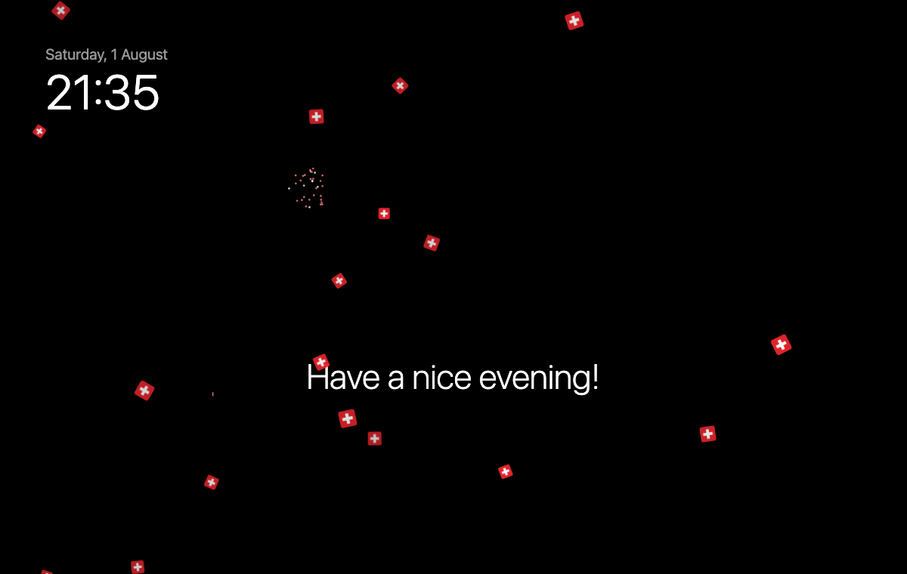
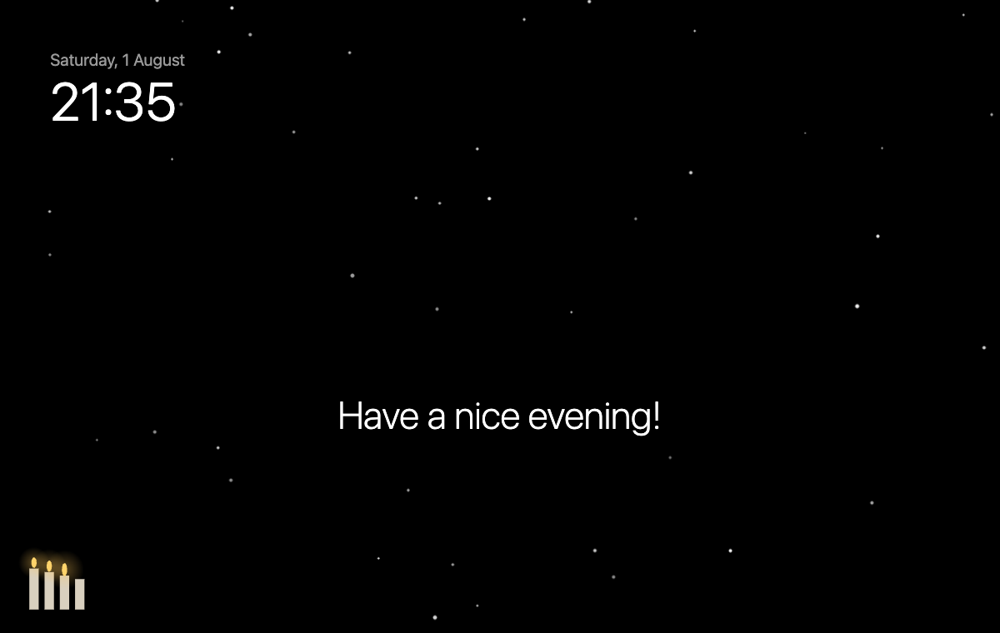
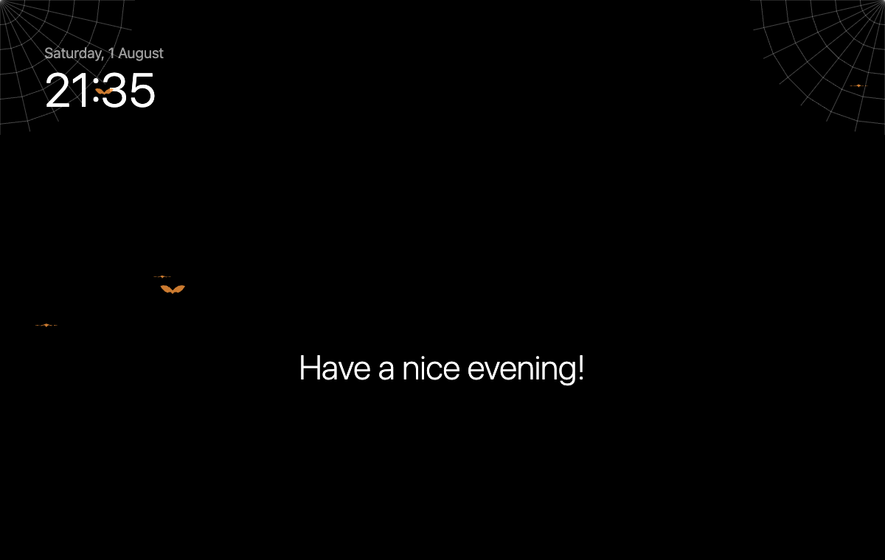
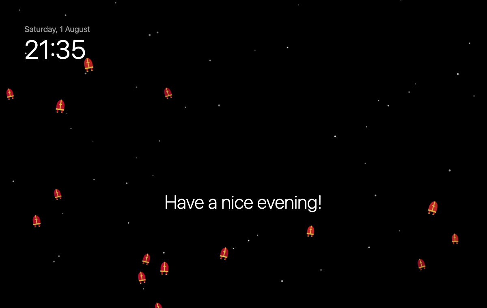
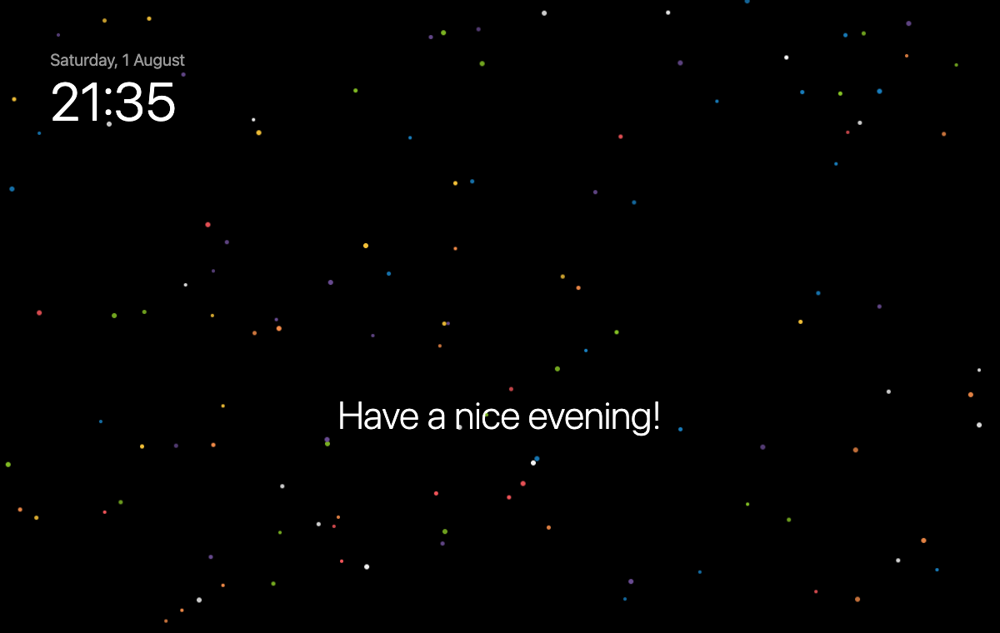
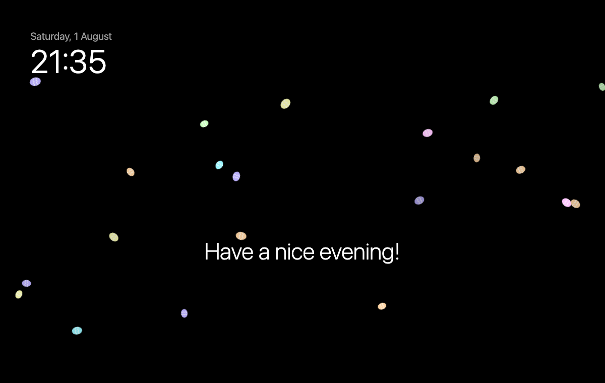

# MMM-SwissOverlay

Swiss holidays and seasons as a quiet full-screen overlay for [MagicMirror²](https://magicmirror.builders/): Swiss flags and fireworks on 1 August, Räppli at Fasnacht, Samichlaus hats on 6 December, Advent candles, and more. The dates move with the calendar (Easter, Fasnacht, Advent, Mother's Day are calculated every year), and **everything is configurable**: switch occasions off, change their dates, add your own (birthdays, anniversaries, your village's events).

It sits in `fullscreen_above`, never blocks clicks or touches, and runs no animation at all on days without an occasion.

| 1 August | Advent | Halloween |
| :---: | :---: | :---: |
|  |  |  |
| **Samichlaus (emoji style)** | **Fasnacht** | **Easter** |
|  |  |  |

## Occasions

| Occasion | id | When (default) | Graphics style | Extras |
|---|---|---|---|---|
| 1 August, Swiss National Day | `bundesfeier` | 1 August | Swiss flags | fireworks from 21:00 |
| Fasnacht | `fasnacht` | Schmutziger Donnerstag … end of Basler Fasnacht (by region, see below) | Räppli confetti | |
| Valentine's Day | `valentine` | 14 February | rising hearts | |
| Easter | `easter` | Good Friday … Easter Monday | painted eggs | |
| Mother's Day | `mothersday` | 2nd Sunday in May | flower petals | |
| Halloween | `halloween` | 24 … 31 October | bats | spider webs |
| Advent | `advent` | 1st Advent … 23 December | snow | 1–4 candles, one per Advent Sunday |
| Samichlaus | `samichlaus` | 6 December | Samichlaus hats (mitres) | snow |
| Christmas | `christmas` | 24 … 26 December | snow | string of lights |
| New Year's Eve, New Year, Berchtoldstag | `newyear` | 31 December … 2 January | golden sparkles | fireworks |
| Epiphany | `threekings` | 6 January | crowns | |

If two occasions fall on the same day, the one higher in this list wins over Advent, Halloween and Fasnacht (e.g. Samichlaus on 6 December). Your own occasions win over all built-in ones.

## Installation

```bash
cd ~/MagicMirror/modules
git clone https://github.com/jjoeojieajfhpdsonf/MMM-SwissOverlay.git
```

No dependencies. Then add it to `config/config.js`:

```javascript
{
	module: "MMM-SwissOverlay",
	position: "fullscreen_above",
	config: {
		region: "all" // Fasnacht: "all", "luzern", "basel" or "zurich"
	}
},
```

The emoji style needs a colour emoji font. On a Raspberry Pi: `sudo apt install fonts-noto-color-emoji`. The Swiss flag is always drawn by the module, because flag emojis don't show on many systems.

## Configuration

With [MagicMirror Manager](https://github.com/jjoeojieajfhpdsonf/magicMirrorManager) you can set everything below in a form, in German or English: switch occasions on and off, change their dates, time of day, look, and add your own (the module describes its settings in `mm-manager.json`). Or write it into `config.js` yourself:

| Option | Default | Description |
|---|---|---|
| `style` | `"graphics"` | `"graphics"` (own, quiet drawings) or `"emoji"`. Can also be set per occasion. |
| `intensity` | `"medium"` | `"low"`, `"medium"` or `"high"` (how many particles) |
| `region` | `"all"` | Fasnacht dates: `"all"` (Schmutziger Donnerstag … end of Basler Fasnacht), `"luzern"` (Schmutziger Donnerstag … Güdisdienstag), `"basel"` (Morgestraich … Wednesday), `"zurich"` (weekend after Ash Wednesday) |
| `opacity` | `1` | Opacity of the whole overlay, 0 … 1 |
| `fps` | `30` | Frames per second; lower values save CPU |
| `occasions` | `{}` | Change or switch off built-in occasions, see below |
| `custom` | `[]` | Your own occasions, see below |
| `forceOccasion` | `null` | Show one occasion now, e.g. `"bundesfeier"`, to try it out |
| `testDate` | `null` | Pretend it is this day, e.g. `"2026-12-06"` |
| `checkInterval` | `60000` | How often (ms) the date and time are checked |

### Changing an occasion

Every occasion takes these settings (all optional):

| Setting | Example | Meaning |
|---|---|---|
| `enabled` | `false` | Switch it off (or write `halloween: false`) |
| `from`, `until` | `"10-15"`, `"11-01"` | Dates, see "Writing dates" |
| `hours` | `["17:00", "23:00"]` | Only at this time of day (may run past midnight) |
| `style` | `"emoji"` | Graphics or emoji for this occasion |
| `emojis` | `["🌹", "❤️"]` | Emojis for the emoji style |
| `colors` | `["#ff6b8b", "#fff"]` | Colours for the graphics style |
| `count` | `40` | Number of particles |
| `speed`, `size` | `1.5`, `0.8` | Multipliers |

Extras: `fireworks` / `fireworksHours` (`bundesfeier`, `newyear`), `candles` / `candlesPosition: "bottom-right"` (`advent`), `lights` (`christmas`), `webs` (`halloween`), `snow` (`samichlaus`).

```javascript
config: {
	style: "graphics",
	occasions: {
		halloween: false,
		valentine: { style: "emoji", emojis: ["🌹", "❤️"] },
		advent: { candlesPosition: "bottom-right" },
		bundesfeier: { from: "07-31", until: "08-01", fireworksHours: ["21:30", "23:30"] },
		easter: { colors: ["#ffd6a5", "#caffbf"] }
	}
}
```

### Your own occasions

```javascript
custom: [
	{ name: "Anna's birthday", from: "06-12", effect: "hearts" },
	{ name: "Holidays", from: "2027-07-10", until: "2027-07-24", style: "emoji", emojis: ["🏖️", "☀️"] },
	{ name: "Chalandamarz", from: "03-01", effect: "confetti", colors: ["#fff", "#e3242b"] },
	{ name: "Fondue night", from: { nth: 1, weekday: "fri", month: 12 }, hours: ["18:00", "23:00"], style: "emoji", emojis: ["🧀"] }
]
```

`effect` is one of `snow`, `confetti`, `sparkles`, `stars`, `flags`, `hearts`, `eggs`, `petals`, `nuts`, `crowns`, `mitres`; `direction: "up"` lets particles rise. Add `fireworks: true` for fireworks.

### Writing dates

| Form | Example | Means |
|---|---|---|
| `"MM-DD"` | `"08-01"` | every year |
| `"YYYY-MM-DD"` | `"2027-06-12"` | once |
| `"easter±N"` | `"easter-2"` | relative to Easter Sunday (Good Friday) |
| `"ashwednesday±N"` | `"ashwednesday-6"` | relative to Ash Wednesday |
| `"adventN±N"` | `"advent1"` | Advent Sundays 1–4 |
| `{ nth, weekday, month }` | `{ nth: 2, weekday: "sun", month: 5 }` | 2nd Sunday in May; `nth: -1` = the last one |
| `{ date, offset }` | `{ date: "easter", offset: 39 }` | any of the above plus/minus days (Ascension Day) |

A window may run into the next year (`from: "12-31", until: "01-02"`).

## Trying it out

Open `preview.html` in a browser: pick an occasion, the style and the intensity, or a date. Or set `forceOccasion` / `testDate` in `config.js`.

## Development

```bash
node --test test/*.test.js
```

When you add a setting or an occasion, describe it in `mm-manager.json` too; the tests check that it matches.

## License

MIT
